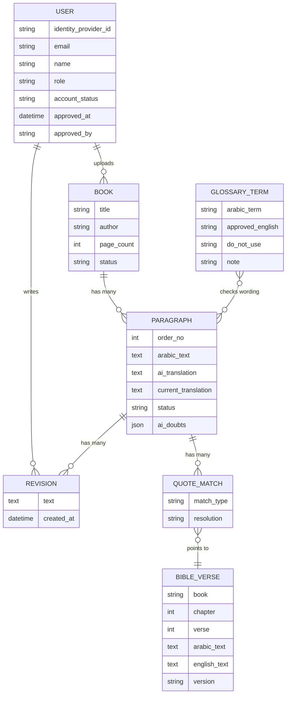

# PRD: Church Book Translation Review (MVP)

Oct 16, 2026 · Abeer

> Live, editable version: https://claude.ai/code/artifact/7ebfb773-badd-4d0f-aa9e-e442a2a5ab41
> This file is a snapshot exported on Oct 16, 2026.

## Overview and problem

The MVP is a web app where an admin uploads an Arabic church book (up to 30 pages), an LLM drafts an English translation, and a reviewer checks every paragraph before the book can be marked review-complete.

**The problem is wording, not grammar.** A general-purpose LLM writes fluent English, but it picks everyday or academic words where the church has an established term. For example, it renders the Pauline phrase as "Old Self", which is theology-textbook language. The church's own Bible wording is "Old Man" (Romans 6:6, Ephesians 4:22). A reader notices these slips right away, and they damage trust in the book.

**So the product is a review tool first and a translation tool second.** Speed of translation does not matter. What matters is how fast a reviewer can spot and fix wrong wording, and how reliably the same correct term is used across the whole book.

### Core flow

1. Admin uploads an Arabic book (PDF, DOCX or TXT, at most 30 pages).
2. The system splits it into paragraphs and translates each one with the LLM, applying the church glossary. It also detects Bible quotes and marks phrases the AI was unsure about.
3. A reviewer reads and checks every Arabic/English paragraph pair, edits the English in place, and explicitly marks each paragraph reviewed. AI highlights help prioritize attention; they never replace reviewing unhighlighted text.
4. Every edit is saved with a diff against the AI draft. AI highlights suggest where closer attention may help, but unhighlighted text still requires review.
5. When every paragraph has been explicitly reviewed and blocking issues are resolved, the book can be marked review-complete and its English text exported.

## Goals and non-goals

The MVP succeeds if a reviewer can turn an AI draft of a 30-page Arabic book into a checked, glossary-consistent English text inside the app, without copying anything into Word.

**Goals**

- Show Arabic and English side by side, aligned paragraph by paragraph.
- Let reviewers edit the English in place, with every change saved automatically.
- Keep a diff of each edit against the AI draft, with who changed it and when.
- Enforce church terminology through an admin-managed glossary that the LLM must follow.
- Detect Bible quotes automatically and make them match the reference Bible (NKJV).
- Let people request accounts, while requiring admin approval before they can access books.
- Point reviewers to the phrases the AI itself was unsure about.
- Require a reviewer to check every paragraph, whether or not AI or automated checks flagged it.
- Track progress by paragraphs explicitly marked reviewed; AI suggestions never reduce the total review requirement.

**Non-goals for the MVP**

- Translation speed or cost optimisation.
- Languages other than Arabic to English.
- Second-phase review, publishing, typesetting or print layout.
- Books over 30 pages, scanned image-only files, handwriting, or OCR. OCR is a later-phase candidate.
- Self-service access without admin approval.

## Personas

The MVP serves two personas: the Reviewer (P0) and the Admin (P1). The other three are planned for later phases.

| Persona | Priority | In MVP | Main job | What they need from the app |
| --- | --- | --- | --- | --- |
| Reviewer | P0 | Yes | Check and correct every paragraph of the AI translation | Parallel text, fast in-place editing, glossary hints, autosave, explicit review confirmation |
| Admin | P1 | Yes | Run the system | Approve account requests, manage users, upload books, manage the glossary, see progress |
| 2nd-Phase Reviewer | Later | No | Approve the first reviewer's work | Diff of reviewer edits, approve/reject per paragraph |
| Publisher | Later | No | Prepare the final book | Export to print-ready formats |
| Project Manager | Later | No | Assign books and track deadlines | Assignment, due dates, team dashboards |

In the MVP, the Admin can also review. A Reviewer is usually a bilingual church servant who knows the church's Bible wording, but is not a professional translator.

## User stories and acceptance criteria

Ten stories make up the MVP. The review stories (US-3 to US-6, US-9, US-10) are the heart of the product.

**US-1 Upload raw material (Admin)**: As an admin, I upload an Arabic book so it can be translated.

- Accepts PDF (with a text layer), DOCX and TXT.
- Rejects files over 30 pages with a clear message showing the page count found.
- Rejects scanned or unreadable files with "No Arabic text found".
- The admin enters a title and optional author before confirming.

**US-2 Auto-translate (System)**: After upload, the book is split into paragraphs, and each one is translated with the LLM.

- Each paragraph keeps its order number and a link to its Arabic source.
- Every glossary term found in the Arabic is sent to the LLM as a required translation.
- Status per paragraph: Translating, Ready, or Failed. Failed paragraphs have a Retry button.
- The reviewer can open the book while some paragraphs are still translating.

**US-3 Read parallel text (Reviewer)**: As a reviewer, I see each Arabic paragraph next to its English draft.

- Arabic is right-to-left on the right; English is left-to-right on the left.
- The rows stay aligned: paragraph N is always next to paragraph N.
- Glossary terms are highlighted in both languages. Hovering shows the approved term.
- A term on the glossary's "do not use" list (e.g. "Old Self") is flagged in red and must be corrected before the paragraph can be marked reviewed.

**US-4 Edit in place (Reviewer)**: I click the English text and type to fix it.

- No separate edit screen or modal.
- Changes autosave within 2 seconds of the last keystroke, with a visible "Saved" state.
- Undo of the last change is available while the paragraph is still focused.

**US-5 Track diffs (Reviewer, Admin)**: I can see what changed from the AI draft.

- A "Show changes" toggle marks deleted words with strikethrough and added words with highlight.
- Each paragraph has a history: version, editor, time.
- "Revert to AI draft" restores the original.

**US-6 Confirm review (Reviewer)**: I confirm a paragraph has been checked and is ready to count as reviewed.

- The reviewer checks every paragraph, then explicitly marks it reviewed. The control and status say "Mark reviewed" and "Reviewed" so this is a human confirmation, not an AI decision.
- Every paragraph counts toward book progress, including paragraphs with no AI doubt mark or other flag. AI highlights and suggestion filters help prioritize attention; they do not imply that unhighlighted text is correct or exempt from review.
- Editing a reviewed paragraph returns it to In review.
- A book cannot be marked review-complete or exported until every paragraph is marked reviewed and all blocking Bible-quote differences and glossary violations are resolved.

**US-7 Manage glossary (Admin)**: I keep a list of approved church terms.

- Each term has the Arabic term, the approved English, "do not use" variants, and an optional note or Bible reference.
- New terms apply to future translations. A "Re-check book" action flags existing paragraphs that break a rule.

**US-8 Request and approve an account (Person, Admin)**: A person requests an account, and an admin approves access.

- A person can register with their name, email, and password, then must verify their email address.
- A verified registration creates a Pending approval profile. Pending users cannot view books, call book APIs, upload books, or review paragraphs.
- An admin can approve or reject a pending profile. Approval assigns the Reviewer role; only an existing admin can grant the Admin role.
- A rejected or deactivated profile cannot access the app. Deactivation does not delete the user's edit history.
- The authentication provider manages passwords and password resets. Tarjama stores the provider's stable user identifier, not the password.

**US-9 Bible verse check (System, Reviewer)**: When the book quotes the Bible, the app finds the verse and checks the English against the reference Bible.

- Each Arabic paragraph is matched against the Arabic Van Dyck Bible. Matching ignores diacritics and spelling variants (أ/ا, ى/ي, ة/ه).
- It finds full and partial quotes, with or without «» marks or a written reference such as (رو 6: 6).
- The matching English sentence gets a blue "Bible quote" highlight showing the reference (e.g. Romans 6:6). Hovering shows the NKJV text.
- If the English differs from NKJV, the differences are marked and the paragraph shows "Verse differs".
- "Use NKJV wording" replaces the sentence in one click. "Keep my wording" keeps it and is logged in the history.
- A paragraph with an unresolved verse difference cannot be marked reviewed.
- Close but not exact wording is shown as "Possible allusion: Psalm 34:18". It is a hint only and never blocks done.

**US-10 AI doubt marks (System, Reviewer)**: The AI tells the reviewer where it was unsure.

- The same translation call returns a short list of phrases the AI was unsure about, each with a reason. Example: مسيرة, "journey" or "walk"?
- These phrases get a dotted amber underline. Hovering shows the reason.
- Doubt marks are hints only. They never replace reviewing the paragraph or block marking it reviewed, and disappear once the paragraph is marked reviewed.

## Functional requirements

P0 items must ship for the MVP to be usable. P1 items ship in the MVP if time allows; otherwise they ship right after it.

| ID | Requirement | Priority | Story |
| --- | --- | --- | --- |
| FR-1 | Side-by-side Arabic (RTL) / English view, aligned by paragraph | P0 | US-3 |
| FR-2 | In-place editing of English text | P0 | US-4 |
| FR-3 | Autosave every edit to the database; nothing lost on refresh | P0 | US-4 |
| FR-4 | Store the AI draft and every saved version per paragraph | P0 | US-5 |
| FR-5 | Show changes (diff) vs the AI draft; revert to AI draft | P0 | US-5 |
| FR-6 | Require an explicit reviewer confirmation for every paragraph; show progress across all paragraphs and allow book completion/export only after all are reviewed and blocking issues are resolved | P0 | US-6 |
| FR-7 | Upload PDF/DOCX/TXT, max 30 pages, split into paragraphs | P0 | US-1 |
| FR-8 | LLM translation per paragraph with glossary terms in the prompt | P0 | US-2 |
| FR-9 | Per-paragraph translation status with Retry | P0 | US-2 |
| FR-10 | Glossary CRUD: Arabic term, approved English, do-not-use list, note | P0 | US-7 |
| FR-11 | Highlight glossary terms; flag do-not-use terms in red | P0 | US-3 |
| FR-12 | Managed email/password sign-in and email verification; Tarjama roles Admin and Reviewer | P0 | US-8 |
| FR-13 | Self-registration creates a pending profile; admins approve or reject requests and can deactivate approved users | P0 | US-8 |
| FR-14 | Paragraph history (version, editor, time) | P1 | US-5 |
| FR-15 | Export finished book to DOCX/TXT | P1 | US-6 |
| FR-16 | Re-check existing book against an updated glossary | P1 | US-7 |
| FR-17 | Filter paragraphs: all, in review, done, glossary flag, Bible quotes | P1 | US-3 |
| FR-18 | Detect Bible quotes by matching Arabic text against the Van Dyck Bible | P0 | US-9 |
| FR-19 | Diff the English quote against NKJV; "Use NKJV wording" and "Keep my wording" | P0 | US-9 |
| FR-20 | Block "Mark reviewed" while a verse difference is unresolved | P0 | US-9 |
| FR-21 | Show AI doubt marks with their reason as attention hints only; never use them to exempt paragraphs from review | P1 | US-10 |
| FR-22 | Admin sets the reference Bible (KJV now, NKJV once licensed) | P0 | US-9 |

## Error handling

Every error tells the user what happened and what to do next. No error ever loses a reviewer's edit.

| Situation | What the user sees | What the system does |
| --- | --- | --- |
| File over 30 pages | "This file has 42 pages. The limit is 30. Split it and upload each part." | Rejects before storing |
| Wrong file type or no text layer | "We couldn't read Arabic text from this file. Upload a PDF with selectable text, a DOCX or a TXT." | Rejects before storing |
| LLM timeout or error on a paragraph | Paragraph shows "Translation failed" + Retry | Retries automatically up to 3 times, then waits for a manual Retry |
| LLM output misses a required glossary term | Paragraph is flagged "Glossary check" | Keeps the draft; the reviewer must correct the do-not-use wording before marking the paragraph reviewed |
| Quote looks like a verse but doesn't match closely | "Possible allusion: Psalm 34:18" hint | Never blocks done; no wording is forced |
| Reference Bible not loaded (e.g. NKJV permission pending) | Banner: "Comparing verses with KJV until NKJV is loaded." | Falls back to KJV |
| LLM returns no doubt list | No amber marks | Review works as normal |
| Person submits a registration | "Check your email to verify your address. Access stays locked until an admin approves your request." | Creates no book access before email verification and admin approval |
| Pending or rejected user signs in | Clear pending/rejected account message | Denies book access and all protected application actions |
| Autosave fails (network down) | Banner: "Offline. Your changes are kept on this device and will save when you reconnect." | Queues edits locally, retries |
| Two reviewers edit the same paragraph | "This paragraph was changed by Mariam 1 minute ago. Reload to see it." | Last save wins only after the user confirms |
| Leaving the page with unsaved edits | Browser "Leave page?" warning | Nothing is lost if the user stays |
| Session expired | Login page, then back to the same paragraph | Unsaved edit is kept locally |

## Data model

Seven tables cover the MVP. The paragraph is the unit of work: it never overwrites its AI draft, so a diff is always possible.

Every save creates a Revision. The diff is current_translation compared with ai_translation, and history is the list of Revisions. BibleVerse holds the reference Bible, loaded once. Each detected quote is saved as a QuoteMatch with how the reviewer resolved it. Authentication credentials stay with the identity provider; User stores its stable identity ID and Tarjama's approval status and role.

## Non-functional requirements

- **Platform**: a web app for desktop browsers (Chrome, Edge, Safari). Review on a phone is read-only friendly, but not a target.
- **Arabic support**: correct right-to-left layout, Arabic web font with full diacritics (tashkeel), no broken ligatures.
- **Persistence**: every saved edit survives refresh, logout and server restart.
- **Privacy**: uploaded books are visible only to logged-in users of the organisation. Book text is sent only to the chosen LLM provider, under a no-training data setting.
- **Licensing**: NKJV is copyrighted. Storing its full text needs written permission from Thomas Nelson. KJV and the Arabic Van Dyck Bible are public domain and can ship now.
- **Performance**: the review page for a 30-page book (about 150 paragraphs) opens in under 3 seconds. Autosave takes under 1 second. Verse detection adds under 1 second per paragraph.
- **Security**: authentication provider manages passwords; Tarjama stores no passwords. HTTPS only, CSRF protection on forms, and authorization checks deny pending, rejected, or deactivated users on every protected API.
- **Accessibility**: keyboard navigation between paragraphs (up and down arrows, Ctrl+Enter to mark reviewed).

## Success metrics

The main signal is how much reviewing the AI draft needs, and whether that shrinks as the glossary grows.

| Metric | How it is measured | MVP target |
| --- | --- | --- |
| Paragraphs accepted without edits | Reviewed paragraphs whose text equals the AI draft ÷ all reviewed paragraphs | Rising book over book |
| Review time per page | Time from first open to book done ÷ pages | Under 15 min per page |
| Glossary violations in reviewed paragraphs | Reviewed paragraphs still holding a do-not-use term | 0 |
| Bible quotes different from NKJV in reviewed paragraphs | Detected quotes left different, not counting "Keep my wording" | 0 |
| Books completed | Books marked done in the first 3 months | 5 pilot books |
| Lost edits | Support reports of edits that disappeared | 0 |

## Out of scope, future phases and open questions

**Out of scope for the MVP**: translation speed, other language pairs, books over 30 pages, publishing and print layout, mobile apps, access without admin approval.

**Future phases**

1. **Phase 2: Quality**. 2nd-Phase Reviewer approves or rejects each paragraph; comments on paragraphs; the glossary learns from repeated reviewer edits (suggested new terms).
2. **Phase 3: Team**. Project Manager assigns books and due dates; dashboards per reviewer.
3. **Phase 4: Publishing**. Publisher exports print-ready DOCX/PDF with the church's styles; more target languages.

**Later candidate**: OCR for scanned Arabic books, with a way for a person to correct uncertain extracted text before translation.

**Open questions**

- [x] Which Bible translation is the reference for English terms? **Answered: NKJV** (KJV until permission is granted).
- [ ] Who asks Thomas Nelson for permission to use the NKJV text in the app?
- [ ] Should Old Testament quotes follow NKJV, or the Septuagint (LXX) wording of the Orthodox Study Bible?
- [ ] Who owns the glossary: one admin, or a committee that approves new terms?
- [ ] Which LLM provider, and is sending book text to it acceptable to church leadership?
- [ ] Which scanned book types and volumes should be prioritized if OCR is added later?
- [ ] Can one book have more than one reviewer at once?
- [ ] Who securely creates the first Admin account before self-registration requests can be approved?
