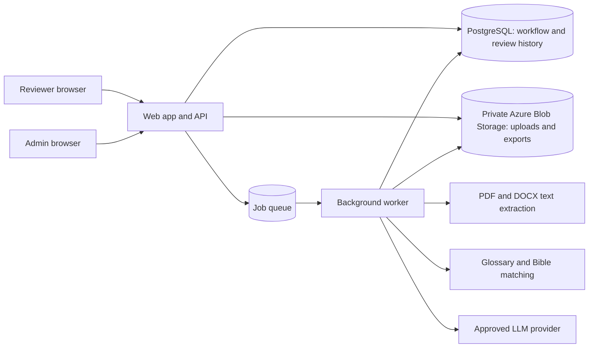

# Tarjama Review: System Design and Project Plan

This document is a design proposal for the MVP, not an implementation specification. It explains the major boundaries, selected and recommended technologies, tradeoffs, and a step-by-step way to make the decisions. Azure is the deployment target; Azure App Service, Azure Database for PostgreSQL, Azure Blob Storage, and Microsoft Entra External ID are selected. Azure Functions with Storage Queue is the working background-job choice; the LLM vendor is still open.

## 1. Start with the problem

The product is a review workflow, not an autonomous translator. Its most important guarantees are:

- A reviewer sees every Arabic paragraph beside its English draft and confirms every paragraph individually.
- A saved human edit is not lost, even if a browser refreshes, a request retries, or a worker fails.
- AI, glossary, and Bible checks can point out concerns, but the system keeps their results distinct from the reviewer's decision.
- Only permitted users can access book text. Book text sent to an AI provider follows an approved privacy and retention policy.

Those guarantees should drive architecture choices more than the choice of a fashionable framework.

## 2. Recommended system shape

Start with one application codebase organized into clear modules, plus a separate worker process for slow jobs. This is a **modular monolith**: one product and one main database, with internal boundaries between responsibilities. The worker can run separately because translation and document processing should not hold a web request open.

**How to read this diagram:** browsers ask the application to do work; the database is the authoritative record of workflow state and edits; private file storage holds large files; a queue lets slow work happen later; the worker performs it and records results. Only the worker should call the LLM. The browser never receives provider credentials.

### Main responsibilities

- **Web app:** sign-in, permissions, book list, upload flow, parallel-text review, autosave, filters, and export requests.
- **Application modules:** users, books, paragraphs, revisions, glossary, Bible checks, and exports. Modules can be separate folders and interfaces without becoming separate network services.
- **Database:** authoritative book/paragraph state, original AI drafts, reviewer revisions, and audit history.
- **Private object storage:** original uploads and generated exports. Do not put large files in database rows.
- **Background worker:** Azure Functions handle extraction, paragraph creation, translation, checks, and export generation. Queue messages carry stable job/book/paragraph IDs, not full book text; the worker reads the source from private storage/database and records status in PostgreSQL.
- **External AI provider:** drafts translation and may return uncertainty hints. It does not decide whether a paragraph is reviewed.

## 3. Technology recommendation

These are starting choices, not commitments. The team’s existing experience, hosting rules, and data policy should influence the final selection.

| Area | MVP recommendation | Why it fits | Main tradeoff / alternative |
| --- | --- | --- | --- |
| Web UI | **Chosen: React + TypeScript** | Suits the interactive parallel-text editor, inline edits, highlights, and Arabic/English directionality | UI and API use different languages; keep their contract explicit and type-checked |
| API and application rules | **Chosen: ASP.NET Core + C# on .NET 10 LTS** | Provides the API hosted with the UI on App Service and the business rules for access, review state, and revisions | Keep provider, database, and UI concerns behind clear module boundaries; update to supported servicing releases |
| Application structure | One repository with a modular ASP.NET Core app; serve the compiled React UI from the same App Service deployment where practical; keep the Functions worker separate | Clear domain boundaries and one interactive-app deployment without adding microservices | Modules need discipline so they do not become tangled. Split deployments only when independent scaling or ownership becomes a real need |
| Relational data | **Chosen: Azure Database for PostgreSQL Flexible Server** | Books, ordered paragraphs, users, revisions, and quote matches have relationships and consistency rules; PostgreSQL transactions protect important updates, and the managed Azure service reduces database operations | Requires schema migrations and database operations. Azure SQL would be reasonable if the church later identifies a SQL Server standard, but PostgreSQL is the chosen fit |
| Uploaded files | **Chosen: private Azure Blob Storage** | Designed for files and access policies; PostgreSQL stores file metadata and a storage key, not the PDF/DOCX/TXT contents | Adds a service and access-control configuration. Keep containers private and authorize downloads through the app |
| Background jobs | **Working choice: Azure Storage Queue + Azure Functions** | OCR/extraction and translation run outside web requests, can retry independently, and scale separately from the review app | Adds Azure resources and asynchronous failure handling. Queue delivery can repeat, so handlers must be idempotent; consider Service Bus only if richer routing, ordering, or delivery controls become necessary |
| User sign-in | **Chosen: Microsoft Entra External ID** for email/password registration and sign-in; keep approval state and roles in Tarjama | The identity provider manages credentials and password resets while Tarjama controls access, approval, and roles | Adds identity-provider setup and vendor dependence. Verify self-registration, email verification, and approval integration before production |
| Document extraction | **MVP: text-based PDF, DOCX, and TXT only**, using established parsers and checks for readable Arabic text | Handles the agreed pilot formats without adding OCR errors or correction work to the first release | Image-only scans are rejected with a clear message. OCR is a later candidate and would need Arabic-quality evaluation plus correction for uncertain text |
| AI integration | A small server-side provider adapter around the chosen LLM API | Keeps credentials and provider-specific details out of the browser and makes a provider change more contained | An adapter cannot make providers equivalent. Translation quality, Arabic support, privacy terms, residency, and cost still need evaluation |
| Main app and API hosting | **Chosen: Azure App Service** for the interactive web app and API; Azure Functions remain separate for background jobs | Managed web hosting keeps the main request/response application separate from slower OCR/extraction and translation jobs | App Service plan, region, scaling, and whether the UI/API share one deployment depend on final stack and pilot requirements |

### Why not microservices yet?

A microservice is a separately deployed system that communicates over a network. It can help when a team needs to scale or release one part independently. Here it would add service discovery, authentication between services, distributed failures, deployment pipelines, and more monitoring before the product has proven its usage. A worker is separate as a process because it has a different runtime job, but it does not need to be a separate business service or codebase.

## 4. Important data and state decisions

### Keep workflow states separate

The PRD currently uses one paragraph `status` for several meanings. In the design, model at least two independent concepts:

- **Translation state:** waiting, processing, ready, or failed.
- **Review state:** not reviewed, in review, or reviewed.

Why separate them? A paragraph may be translation-ready while still needing human review. A failed translation cannot be reviewed yet. Combining both concepts into one status creates confusing combinations and makes progress calculations unreliable.

Also represent **blocking checks** separately from review state. For example, a reviewer may have inspected a paragraph, but a prohibited glossary term or unresolved verse difference still prevents it from counting as complete. Whether such a paragraph should display "In review" or "Reviewed, issue unresolved" is a product wording decision; it should not be hidden inside a single status field.

### Keep sign-in separate from account approval

Registration proves that a person controls an email address; it does not grant access. The proposed account lifecycle is:

1. The person registers through the identity provider and verifies their email.
2. Tarjama records a profile with `PendingApproval`; it has no application role and cannot access books or protected APIs.
3. An existing admin approves or rejects the request. Approval assigns the default `Reviewer` role; only an admin can grant `Admin`.
4. On each sign-in and protected request, Tarjama checks the identity-provider user ID, account status, and role. Rejected or deactivated users remain blocked, but their existing revision history is retained.

This boundary matters because a valid sign-in token only proves identity. The application must still authorize the person. The identity provider stores credentials; Tarjama stores the stable provider ID, email/name, account status, role, and approval audit fields. Never grant the first person who registers the Admin role. Bootstrap the initial admin through a controlled deployment/operations step.

### Preserve source and history

For each paragraph, preserve:

- Its stable ID, order in the book, and Arabic source text.
- The original AI draft, which is never overwritten by reviewer edits.
- Reviewer revisions, including editor, time, and the text or change made.
- The current displayed translation, either stored as the latest value or derived from the latest revision.
- The glossary/Bible check results and the version of the rules used for those results.

The original draft is the baseline for comparison. Revisions are the audit trail. The displayed current text is a convenience; it must never be the only copy of the user's work.

### Make updates safe under retries and simultaneous edits

- Save revisions transactionally: a revision and the paragraph's current state should not disagree.
- Give edits a version number. If another reviewer saves a newer version first, reject or pause the stale update and ask the user to reload or reconcile; do not silently overwrite it.
- Give every background job a stable identity so retrying the same job does not create duplicate paragraphs or replace a human edit.
- Retry temporary provider failures with limits. Keep permanent failures visible and actionable.

These are examples of **idempotency** (repeating an operation has the same effect) and **optimistic concurrency** (detecting a collision instead of locking everyone out).

## 5. End-to-end flow

1. **Upload:** authorize the admin, validate file type and size, store the file privately, and create a book record.
2. **Extract:** enqueue work; parse the PDF/DOCX/TXT; confirm Arabic text is present; split it into ordered paragraphs. Keep enough source metadata to diagnose extraction problems.
3. **Translate:** enqueue one job per paragraph (or a small bounded group). Send only the needed source text and glossary context to the approved provider. Store the immutable AI draft, provider/model metadata, and optional doubt hints.
4. **Check:** run glossary and Bible checks. Treat uncertain matches as suggestions. Apply only the agreed blocking rules; never present a likely AI match as certainty.
5. **Review:** load authorized paragraphs; save every edit as a revision; show autosave state; record an explicit reviewer confirmation for each paragraph.
6. **Complete:** calculate progress from all paragraphs, not just suggested ones. Permit completion/export only when all required review confirmations and blocking checks pass.
7. **Export:** generate DOCX/TXT from the reviewed current translations, preserve paragraph order, and make the resulting file available only to authorized users.

A queue makes this flow resilient: a request can finish quickly after recording the job, while the worker continues. The page can show `Translating`, `Ready`, or `Failed` without pretending a long AI call is instant.

## 6. System design principles, using this project

- **Start from invariants.** An invariant is a rule that must always be true. Here: no book is complete until every paragraph has explicit reviewer confirmation; an AI draft is never allowed to erase a reviewer revision.
- **Separate responsibilities, not everything.** Keep document parsing, translation, checks, and review logic understandable as modules. Do not create network services unless independent deployment has a concrete benefit.
- **Use the database as the source of truth.** The browser can cache text for offline recovery, but the durable review history belongs on the server. Avoid having two competing authoritative copies.
- **Make slow work asynchronous.** User-facing requests should not wait minutes for translation. Queues also give you visible status and controlled retries.
- **Assume failure and repetition.** Networks time out; workers restart; users double-click. Design operations to be safe when retried and make failures visible.
- **Keep uncertainty visible.** AI doubt and possible Bible allusions are hints with provenance, not facts. Store how a result was produced and let the reviewer make the decision.
- **Minimize sensitive data movement.** Keep uploads private, send the minimum necessary text to the provider, avoid logging book content, and check retention/training terms before choosing a provider.
- **Prefer reversible choices early.** Framework and hosting can change, but book text, revision history, and user decisions are difficult to reconstruct. Invest more care in durable data and exports than in premature service splitting.

## 7. Project plan: decide, prove, then expand

### Stage 1: Resolve policy decisions

Before committing to vendors, answer:

- Is sending book text to an external LLM acceptable, and under what retention, training, and data-location terms?
- Is NKJV text licensed for storage and display? Until written permission is confirmed, use the permitted reference text already selected by the church.
- Can multiple reviewers work on one book at the same time? What should happen on a conflict?
- Which representative text-based PDFs/DOCX/TXT should be used to verify extraction and paragraph order in the pilot?
- Who owns glossary changes and approves them?

These affect architecture more than small framework preferences.

### Stage 2: Write acceptance rules and state transitions

Define the exact paragraph states and which issues block review completion. Check that the PRD, wireframe, and future tests use the same language. In particular, distinguish "reviewer checked this" from "all automated checks pass."

### Stage 3: Prove a thin vertical slice

Build one narrow path before filling out every screen: an authorized user opens a sample book, views one Arabic/English paragraph, edits it, saves it, refreshes, and sees the same text and history. This tests the riskiest product promise: no lost edits.

### Stage 4: Add ingestion and background work

Add upload validation, text extraction, stable paragraph ordering, queue/worker behavior, translation status, retries, and provider error handling. Use a fixed test provider in automated tests so tests do not depend on paid network calls.

### Stage 5: Complete the reviewer workflow

Add all paragraphs, autosave, edit history, conflict detection, explicit review confirmation, full-book progress, glossary flags, Bible check resolution, and export gating. Verify Arabic direction, punctuation, selection, and keyboard navigation in real browsers.

### Stage 6: Pilot and measure

First compare a small number of LLM candidates using 20-30 representative Arabic paragraphs from text the church has approved for provider testing. Include church-specific glossary terms, Bible quotations, idioms, ambiguous wording, and ordinary prose. Give every candidate the same source text, glossary, instructions, and output format; hide provider names from reviewers while they score the results.

Score meaning preservation, omissions or unsupported additions, approved-term consistency, Bible-quote handling, readable English, and whether uncertainty hints are useful. Separately compare provider data-retention/training terms, permitted data location, availability in the chosen Azure region, expected cost at pilot volume, and operational limits. Agree on minimum quality and policy requirements before seeing the scores. Choose a provider only if it meets those requirements; reviewers still check every paragraph regardless of model score.

After privacy and copyright rules are cleared, pilot with a small set of real books. Measure review time, glossary violations, lost edits, provider failures, and how often AI hints are useful. Use those results to choose the next investment rather than optimizing hypothetical scale.

## 8. Tradeoffs to revisit with evidence

| Decision | Start simple | Revisit when... |
| --- | --- | --- |
| Modular monolith vs microservices | One application and one worker process | Teams need independent releases, one workload scales very differently, or deployment failures need isolation |
| Azure Storage Queue vs a richer broker | Azure Storage Queue + Functions for the MVP | The workflow needs ordered sessions, richer routing, or delivery controls that justify Azure Service Bus |
| Text-only MVP vs OCR | Accept text-based PDF/DOCX/TXT; reject image-only scans clearly | Add OCR later if scan volume justifies its Arabic recognition errors, service cost, and human correction workflow |
| One reviewer vs concurrent review | Support concurrent users safely, but detect conflicting paragraph edits | Product policy needs assignment/locking or formal second review |
| Provider adapter vs multi-provider routing | One selected provider behind a small boundary | Evaluations show another provider materially improves Arabic quality, privacy, or cost |

## 9. Decisions still open

- **Azure deployment details:** choose region, environment separation, App Service plan, Function hosting plan, scaling, availability, backup retention, and estimated cost after confirming data-residency needs and expected pilot usage.
- **LLM provider/model:** complete the blinded quality and provider-policy comparison above before selecting a model or sending real books.
- **Authentication setup:** verify Entra External ID supports the intended self-registration, email verification, password reset, and Tarjama approval flow; confirm deactivation behavior, audit needs, and cost before production.
- **Initial admin bootstrap:** decide who creates the first admin securely; never let public self-registration choose an Admin role.
- **Bible text policy:** NKJV usage is blocked on licensing; the data model should support versioned reference texts without assuming permission.
- **Multiple-reviewer policy:** define whether concurrent editing is allowed and whether future second-stage approval is required.

## 10. Decision checklist

When comparing two technologies or designs, ask:

1. Which actual requirement does this choice satisfy?
2. What is the simplest option that satisfies it?
3. What new failure modes, operating work, or vendor dependence does it introduce?
4. How hard will it be to change later, and what data would be at risk?
5. What small test or pilot can provide evidence before committing?

For this MVP, a strong default is to keep the runtime architecture simple and spend the design effort on durable revisions, clear review states, privacy, and recovery from AI/document-processing failures.
